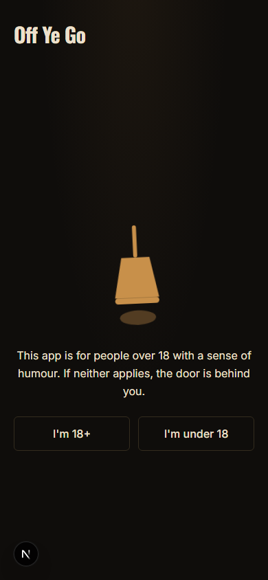
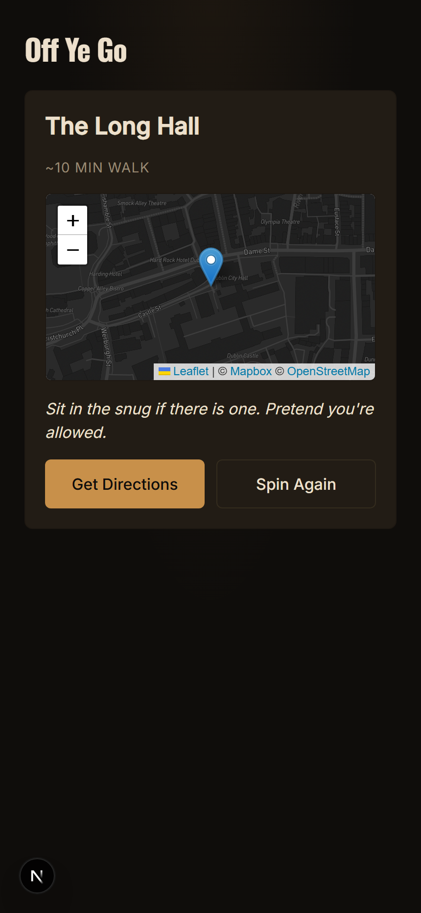

# Off Ye Go

Can't pick a pub? Off ye go. We'll pick one for you.

<p align="center">
  
  &nbsp;&nbsp;
  
</p>

**Live at [offyego.ie](https://offyego.ie)**

---

## Why it exists

Dublin has over 700 pubs. The island has over 7,000. None of that helps when you're standing on a footpath at six on a Friday and six people are staring at their phones, each waiting for someone else to decide.

Off Ye Go was built to solve that exact moment. Not with a list, not with reviews, not with a map full of pins. Just: here is a pub, here is how long it takes to walk there, now go.

The sarcasm is intentional. Decision fatigue does not deserve a sympathetic interface.

---

## What it does

1. Confirms you are in the Republic of Ireland and over 18
2. Finds every pub and bar within your chosen radius using live OpenStreetMap data
3. Spins through them and picks one at random
4. Shows you the name, walking time, a map, and a small dare to do when you arrive
5. Gets out of your way

Republic of Ireland only. Northern Ireland is excluded by design -- the Overpass query, the polygon check, and the personality copy all assume you are on the right side of the border.

---

## Two personalities

Off Ye Go ships with two distinct voices, each with its own visual theme.

**Grumpy Barman** -- dry, sparse, tired of you. Dark backgrounds, warm amber pendant-lamp accent, a dark street map. Talks to you like you have interrupted something important.

**Local Lad** -- louder and friendlier, full of "ya" and "feckin'" and Sunday-afternoon energy. Deep Irish green, GAA red accent, a terrain-focused map. Talks to you like he has been waiting for an excuse.

Toggle between them on the ready screen. The entire app changes mood in place: copy, colour, typography, map style, and the animation on the age gate. Every user-facing string lives in a voice file. No hardcoded English in components.

---

## Stack

| Layer | Choice |
|---|---|
| Framework | Next.js 16, React 19, App Router, TypeScript strict |
| Styling | Tailwind v4, CSS custom properties for theming |
| Map | Leaflet + react-leaflet, Mapbox raster tiles (dark-v11 / outdoors-v12) |
| Pub data | Overpass API against OpenStreetMap, via `/api/overpass` proxy |
| Walk time | Mapbox Directions API (walking profile), haversine fallback |
| Error tracking | Sentry |
| Hosting | Vercel |
| Tests | Vitest, 48 tests |

No database. No accounts. No backend beyond one proxy route. Just a button and a pub.

---

## Running it locally

```bash
npm install
npm run dev
```

Open [http://localhost:3000](http://localhost:3000). Geolocation works on localhost over HTTP by browser exemption.

To test on a real mobile device over your LAN (`http://192.168.x.x:3000`), HTTPS is required -- use Vercel preview deployments for mobile testing instead.

You will need a `.env.local` with:

```
NEXT_PUBLIC_MAPBOX_TOKEN=your_mapbox_token
```

---

## Contributing

PRs welcome. The project has a strong opinionated voice, so please read `MASTER_PROMPT.md` before opening one.

- No em-dashes in user-facing copy
- No emoji in UI
- All user-facing strings go in `src/constants/voices.*.ts`, never inline in components
- TypeScript strict -- no `any`
- If adding a challenge or voice variant, match the existing tone

---

## Licence

MIT. See LICENSE.
